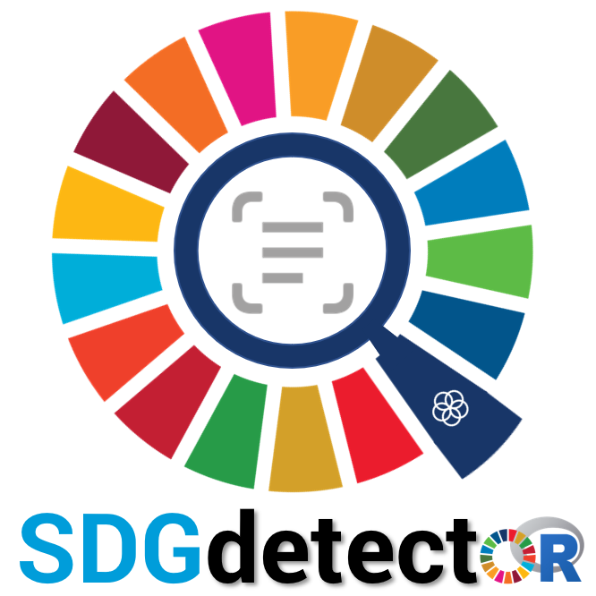
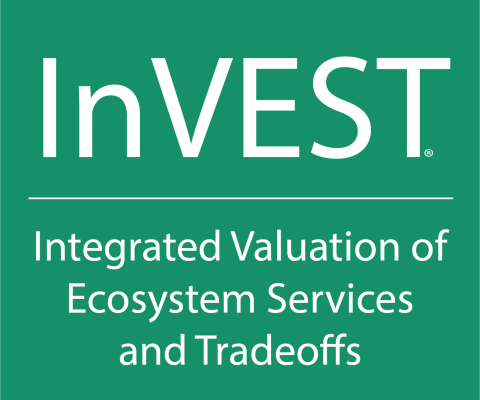

## Yingjie Li

I am a **Senior Scientist** with the [Natural Capital Alliance](https://naturalcapitalproject.stanford.edu/) at Stanford University. My research integrates geospatial data science, ecosystem service modeling, and sustainability science to understand how nature contributes to human well-being and to develop and advance open-source tools that inform sustainability planning and policy. My research spans urban nature and health, ecosystem services, and coupled human–natural systems, with broader interests in international trade and the land–food–energy–water nexus. 

I earned my Ph.D. in Environmental Science & Policy, as well as Fisheries and Wildlife from Michigan State University, where my research at the Center for Systems Integration and Sustainability examined how [telecoupled](https://telecouplingtoolbox.org/) human–natural systems shape global sustainability and progress towards the [Sustainable Development Goals (SDGs)](https://sdgs.un.org/goals). 

Learn more about my research on my [personal website](https://yingjieli.netlify.app/).

---

### Selected Publications

<!-- HASHNODE:START -->
- [**Nature Cities** - Acute mental health benefits of urban nature](https://www.nature.com/articles/s44284-025-00286-y)
- [**Remote Sensing of Environment** - Satellite prediction of coastal hypoxia in the northern Gulf of Mexico](https://doi.org/10.1016/j.rse.2022.113346)
- [**Environmental Science & Policy** - Synthesizing social and environmental sensing to monitor the impact of large-scale infrastructure development](https://doi.org/10.1016/j.envsci.2021.07.020)
- [**Nature Sustainability** - Impacts of international trade on global sustainable development](https://doi.org/10.1038/s41893-020-0572-z)
- [**Nature** - Assessing progress towards sustainable development over space and time](https://doi.org/10.1038/s41586-019-1846-3)
<!-- HASHNODE:END -->

---

### Open-source Software

- **R package:** [SDGdetector](https://github.com/Yingjie4Science/SDGdetector) 

- **Python package:** [seesus](https://github.com/caimeng2/seesus)

- [**InVEST models**](https://github.com/natcap/invest) 

---

  
  

<!--  -->
